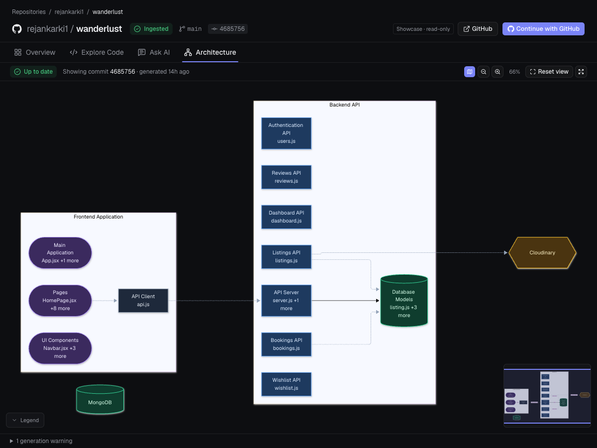
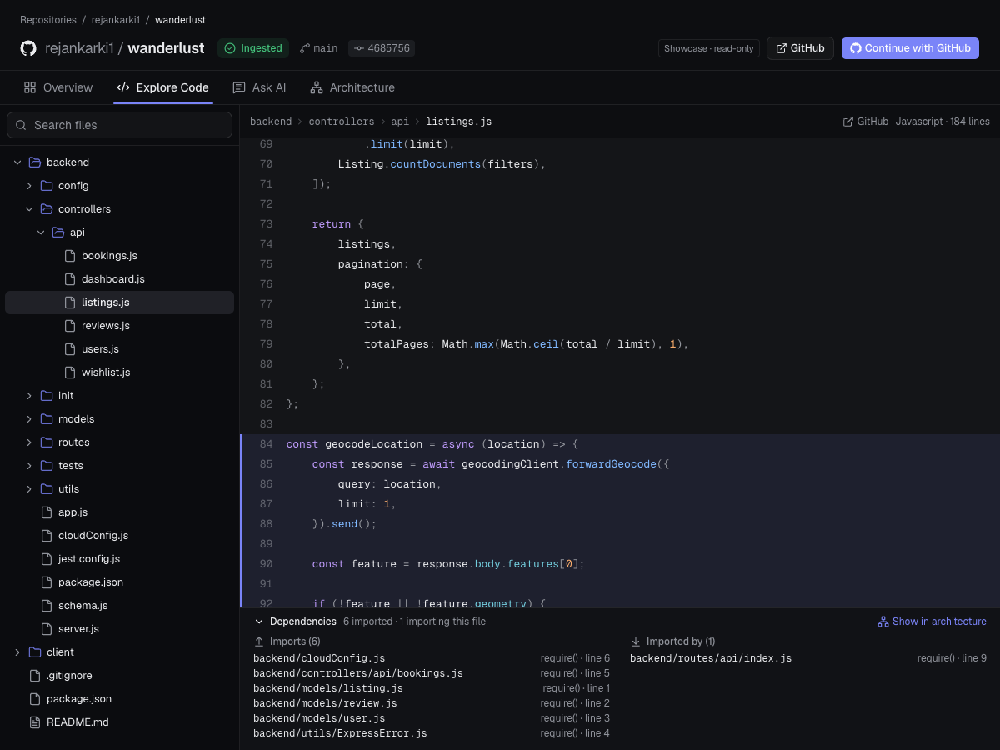
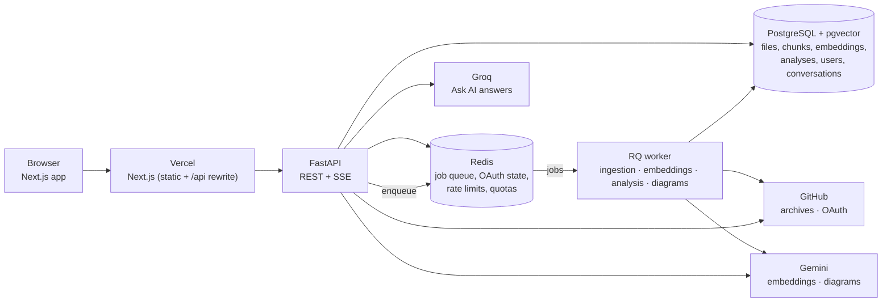

# RepoLens

**Understand any public GitHub repository: browse its code, see how its components connect, and ask questions that are answered from the source itself, with citations to the exact files and lines.**

**Live demo:** <https://repo-lens-bice.vercel.app> — two real repositories are open to visitors without an account.

[](https://github.com/rejankarki1/repoLens/actions/workflows/backend-ci.yml)
[](https://github.com/rejankarki1/repoLens/actions/workflows/frontend-ci.yml)
[](https://github.com/rejankarki1/repoLens/actions/workflows/e2e-smoke.yml)

## What RepoLens does

Paste the URL of a public GitHub repository. A background worker downloads it, stores its files, splits the code into structure-aware chunks with tree-sitter, indexes them for keyword and semantic search, and maps the imports between files. You then get three views of the repository:

- **Ask AI** answers questions from retrieved code only. Every answer carries `[S1]`-style citations that are validated against what was actually retrieved; clicking one opens the cited lines.
- **Code Explorer** is a file tree and source viewer with line deep links and a per-file panel of what it imports and what imports it.
- **Architecture Explorer** is an AI-identified diagram of the repository's functional components, in which every relationship is marked as verified by a real import or merely inferred.

Sign-in is GitHub OAuth with no scopes (public profile only). Each user has a private workspace and private conversations; the stored copy of a public repository is shared by everyone who analyzes it.

## Screenshots

These are the screenshots used on the live landing page, taken from the current application on the Wanderlust demo repository.

| Ask AI with cited sources | Architecture Explorer |
| --- | --- |
|  |  |



## Core features

- **Repository ingestion** from a GitHub URL, run by a Redis/RQ worker with progress shown in the UI, one retry for transient failures, heartbeats and stale-job recovery.
- **Hybrid code retrieval**: PostgreSQL full-text search, exact symbol/file-name matching and pgvector similarity, fused with Reciprocal Rank Fusion and scoped to the repository's current commit. Works keyword-only when no embedding key is configured.
- **Grounded answers with citations** streamed token by token. Citations are rebuilt from the retrieved chunks (path, lines, commit are never model output); markers that match nothing retrieved are removed.
- **Repository-structure questions** ("where is the entry point?") get extra evidence: entry points detected in the code and declared by manifests, plus one hop of their imports.
- **Deterministic architecture analysis** of imports (Python, JavaScript, TypeScript, TSX) with evidence for every edge, run automatically after ingestion. Its counts appear on the Overview tab and feed the per-file Dependencies panel.
- **AI architecture diagram**, generated on request by a member, validated claim by claim against the deterministic graph, rendered with Mermaid with pan, zoom, minimap, focus highlighting and a details panel linking to real files.
- **Saved conversations** with automatic titles, rename, delete and clear.
- **GitHub sign-in**, server-side sessions, CSRF protection, per-user workspaces, and a read-only **guest showcase** of allow-listed repositories with curated example answers. Visitors can optionally ask a few live questions a day.
- **Usage limits** enforced atomically in Redis: AI questions per user and globally, imports, embedding and diagram jobs, guest reads and sign-in attempts.

## System architecture



In production the browser only talks to the Vercel origin: `/api/*` is rewritten to the Render service, so the session cookie stays first-party and no CORS is involved. One Render container runs the API and the single worker under a small supervisor. Which provider writes Ask AI answers is a setting (`GENERATION_PROVIDER`: Gemini or Groq); the hosted demo uses Groq for answers and Gemini for embeddings and architecture diagrams.

## Repository ingestion and indexing

1. **Validate and queue.** `POST /repositories` checks the URL (GitHub only, `owner/name` rules, no credentials or ports) and creates the repository row, or adds you to the stored copy if someone already imported it. The web app then requests an ingestion (`POST /repositories/{id}/ingestions`), which is refused with 409 while one is already queued or running.
2. **Download.** The worker resolves the default branch's commit and streams the zipball to a temporary file. Archives over `GITHUB_ARCHIVE_MAX_BYTES` (25 MiB by default, 10 MiB on the hosted demo) are rejected.
3. **Read safely.** Entries are filtered as they are read: dependency directories, lockfiles, minified bundles, source maps, binaries, Git LFS pointers, files that look generated and files that look like credentials are skipped. At most 5,000 files, 1 MiB per file and 50 MiB in total are accepted; a repository that exceeds a limit is stored with an `ingestion_truncated` flag the UI shows.
4. **Store the snapshot.** Files are written in one transaction, tagged with the commit SHA. A re-ingestion replaces the snapshot only on success; a failure keeps the previous one, which the UI keeps serving.
5. **Chunk.** Python, JavaScript, TypeScript and TSX are parsed with tree-sitter into chunks of up to 1,500 bytes that follow the code's structure (functions, classes, methods) and record symbol names, line ranges and byte offsets. Other text files are chunked as plain text.
6. **Index.** Every chunk gets a weighted `tsvector` (paths and symbols rank above code) for keyword search. If `GEMINI_API_KEY` is set, an embedding job is queued: `gemini-embedding-001` at 1,536 dimensions, stored by content hash so unchanged chunks are never re-embedded. Up to `EMBEDDING_MAX_CHUNKS_PER_REPOSITORY` chunks are embedded (10,000 by default, 3,000 on the hosted demo); the rest stay keyword-searchable.
7. **Analyze.** A deterministic architecture analysis of the imports is queued; up to `ARCHITECTURE_MAX_FILES` (5,000) code files are analyzed.

The repository status (`queued → in_progress → completed | failed`) lives in PostgreSQL and is polled by the UI while a job is active.

## RAG retrieval and AI answer pipeline

1. **Retrieve.** The question runs through the hybrid search (keyword, exact, semantic; 50 candidates per retriever; `score = Σ 1 / (60 + rank)`), scoped to the current commit. A missing key or a provider outage degrades to keyword results with a warning; one query embedding at most per question.
2. **Discover structure** for questions that name no symbol: entry points found in the code (a listening server, a UI mount, a `main` guard) and declared by manifests (`package.json`, `pyproject`, `Procfile`, `Dockerfile`), mapped to their stored chunks so they are citable too.
3. **Build a bounded prompt.** Up to 8 excerpts and 24,000 characters, labelled `S1`, `S2`…, with path and lines, plus the last 6 conversation messages. Excerpts are untrusted: they sit inside delimiters with a per-request random token and the system prompt forbids following instructions found in them.
4. **Generate and stream.** The selected provider (Groq `llama-3.3-70b-versatile` or Gemini `gemini-3.5-flash` by default) answers over server-sent events (`retrieval`, `token`, `done` or `error`). Nothing is generated if retrieval finds nothing.
5. **Validate citations.** `[S#]` markers that match no retrieved excerpt are removed; the citation list is rebuilt from the retrieved chunks; file names mentioned but not retrieved are returned as warnings.
6. **Save** the question and answer together only after a complete answer. Provider errors, truncated output and abandoned streams save nothing and do not use the daily quota.

The **AI architecture diagram** reuses the same provider classes with a one-shot prompt built from the deterministic analysis (modules, edges, entry points, manifests, representative excerpts). The model proposes components and relationships; the backend drops any source path not in the snapshot and recomputes every relationship's confidence from real import edges, so `verified` can never be asserted by the model.

## Technology stack

| Area | Technology |
| --- | --- |
| Web app | Next.js 16 (App Router), React 19, TypeScript, Tailwind CSS 4, SWR, Base UI/shadcn components, Mermaid |
| API | Python 3.14, FastAPI, SQLAlchemy 2 (async, asyncpg), Alembic, httpx, Pydantic Settings |
| Background jobs | Redis, RQ (one worker, retries scheduled by RQ) |
| Code parsing | tree-sitter via `tree-sitter-language-pack` |
| Database and vectors | PostgreSQL 17, pgvector (1,536-dimension vectors, cosine distance) |
| AI providers | Google Gemini (`gemini-embedding-001` embeddings; answers and diagrams optional), Groq (answers) |
| Authentication | GitHub OAuth (authorization code + PKCE, no scopes), server-side sessions |
| Hosting (demo) | Vercel (web), Render (API + worker, Docker), Neon (PostgreSQL), hosted Redis |
| Testing | pytest (real PostgreSQL and Redis), `node --test` unit tests, a headless-Chrome smoke test with a fake GitHub |

## Local development setup

You need Python 3.14, Node.js 22.18 or newer, and Docker. Run every command from the repository root unless noted.

```bash
# 1. Local settings and services (PostgreSQL with pgvector, Redis)
cp .env.example .env
docker compose up -d && docker compose ps

# 2. API: virtual environment, dependencies, migrations, tree-sitter grammars (downloaded once)
python3 -m venv apps/api/venv
apps/api/venv/bin/python -m pip install -r apps/api/requirements-dev.txt
apps/api/venv/bin/alembic upgrade head
apps/api/venv/bin/python -c "from apps.api.services.code_parser import ensure_grammars; ensure_grammars()"

# 3. Web app dependencies
(cd apps/web && npm ci)
```

Start each process in its own terminal:

```bash
docker compose up -d                                              # PostgreSQL + Redis
apps/api/venv/bin/uvicorn apps.api.main:app --reload --port 8765  # FastAPI
apps/api/venv/bin/python -m apps.api.worker                       # RQ worker
cd apps/web && npm run dev                                        # Next.js on http://localhost:3000
```

Open `http://localhost:3000` (use `localhost`, not `127.0.0.1`: the session cookie needs the web app and the API on the same site). `http://localhost:8765/docs` is the API reference and `/health/ready` reports PostgreSQL and Redis.

**Sign-in and AI are optional locally.** Without a GitHub OAuth App nobody can sign in or import, but a showcase repository you have imported another way is still browsable. Without `GEMINI_API_KEY`, search is keyword-only and no diagrams can be generated; without a Groq or Gemini key, Ask AI returns 503.

To enable sign-in, create a GitHub OAuth App (Settings → Developer settings → OAuth Apps) with homepage `http://localhost:3000` and callback `http://localhost:8765/auth/github/callback`, and put its id and secret in `.env` (or in `.env.oauth-check`, an optional overlay that also points the API at a separate database, Redis database and queue; see [docs/oauth-verification.md](docs/oauth-verification.md)). To let visitors browse without signing in, import repositories first and list them in `GUEST_SHOWCASE_REPOSITORIES`.

| Symptom | Fix |
| --- | --- |
| `ConnectionRefusedError` on port 5433 or 6379 | Docker is not running: start it, then `docker compose up -d`. |
| `No script_location` from Alembic | Run it from the repository root. |
| Imports stay "queued" | The worker is not running, or listens on another `INGESTION_QUEUE_NAME`. |
| Indexing stuck at "embedding" | Gemini's free tier rate-limits embeddings; use **Resume indexing** in the Ask AI panel. |

## Environment variables

All settings are read by `apps/api/config.py` from `.env` (and `.env.oauth-check` if present); shell variables override both. `.env.example` lists them with their defaults. The main ones:

| Variable | Purpose |
| --- | --- |
| `DATABASE_URL`, `REDIS_URL` | PostgreSQL (asyncpg; a provider-style `postgresql://…?sslmode=require` URL is converted) and Redis |
| `WEB_ORIGINS`, `WEB_BASE_URL`, `API_PUBLIC_URL` | CORS/CSRF allow-list, where the browser returns after sign-in, and the API's public URL (the OAuth callback is `<API_PUBLIC_URL>/auth/github/callback`) |
| `GITHUB_OAUTH_CLIENT_ID`, `GITHUB_OAUTH_CLIENT_SECRET` | The GitHub OAuth App (secret: `.env` or the host's secret store only) |
| `GITHUB_TOKEN` | Optional token for GitHub API calls (60 → 5,000 requests per hour) |
| `GEMINI_API_KEY`, `EMBEDDING_MODEL`, `GEMINI_GENERATION_MODEL` | Embeddings (required for semantic search) and Gemini answers |
| `GENERATION_PROVIDER`, `GROQ_API_KEY`, `GROQ_GENERATION_MODEL` | `gemini` (default) or `groq` for Ask AI answers; no automatic fallback |
| `ARCHITECTURE_DIAGRAM_GENERATION_PROVIDER` | Provider for diagram generation only (the demo uses `gemini` because a diagram prompt exceeds the Groq model's request limit) |
| `GUEST_SHOWCASE_REPOSITORIES` | `owner/name` list visitors may browse read-only; nothing is public unless listed |
| `GUEST_AI_ENABLED`, `GUEST_AI_*` | Optional live questions for visitors, capped per visitor and for all visitors |
| `AI_*`, `IMPORT_*`, `EMBEDDING_*`, `ARCHITECTURE_*`, `MAX_*` | Usage limits and size caps (defaults in `.env.example` and `apps/api/config.py`) |
| `ENVIRONMENT=production` | Secure `__Host-` cookies, HSTS and CSP, API docs off, and a start-up check that refuses unsafe settings |
| `NEXT_PUBLIC_API_URL`, `API_ORIGIN` (web app) | Where the browser finds the API (`/api` in production, proxied to `API_ORIGIN`); build-time values, never secrets |

Never commit `.env` or put a secret in a `NEXT_PUBLIC_*` variable. [docs/deployment.md](docs/deployment.md) has the production checklist.

## Testing

```bash
apps/api/venv/bin/python -m pytest -q                 # backend: needs local PostgreSQL + Redis; uses its own repolens_test database and Redis db 15
cd apps/web && npm test && npm run typecheck && npm run lint && npm run build
python -m tests.e2e.run_smoke                        # browser smoke test: boots an isolated stack with a fake GitHub (needs Chrome)
```

The backend suite never reaches development data: before the settings are read, `tests/conftest.py` points them at a disposable database, Redis database and queue, blanks every provider key, and refuses to run against a non-local host or a database it did not create. The smoke test does the same with its own database (`repolens_e2e`), Redis database 9 and ports, and drives headless Chrome through sign-in, the guest showcase, the paste-URL import flow, isolation between users and repository removal. All three run in GitHub Actions on every push and pull request to `main`, with throwaway services and no AI, OAuth or GitHub credentials.

## Limitations and future improvements

- **Public repositories only**, and size-limited: archives over 25 MiB (10 MiB on the hosted demo), files over 1 MiB, and anything beyond 5,000 files or 50 MiB per repository are skipped, so very large monorepos are stored partially and flagged as truncated.
- **Structure-aware parsing covers Python, JavaScript, TypeScript and TSX.** Other languages are indexed as plain text and do not appear in the import graph or the architecture diagram.
- **Semantic search is capped** at 10,000 embedded chunks per repository (3,000 on the demo); the remainder is keyword-only. There is no approximate-nearest-neighbour index yet, which is fine at this scale.
- **Answers are only as good as retrieval.** The model sees at most 8 excerpts, so broad questions about a large repository can miss relevant code; the citations make this visible rather than hidden.
- **The AI diagram is model output**, bounded by the deterministic analysis it reads and non-deterministic between runs; relationships other than imports are always marked inferred.
- **No answer caching**: every question is a live retrieval and generation. Repeated questions cost a provider call each time (within the per-user and global quotas).
- **The hosted demo runs on free tiers.** The API sleeps after idle and takes up to a minute to wake, so the first request of a visit is slow; the worker sleeps with it, so queued imports wait for the next visit. Quotas are deliberately low.
- **Per-IP limits behind the hosting proxies act as one shared bucket** (proxy addresses are not trusted by default), which can only over-limit, never under-limit.
- Possible next steps: more tree-sitter grammars, an HNSW index once repositories grow, account deletion and data export, and garbage collection of embeddings whose repositories were removed.

## Repository layout

```text
apps/api/        FastAPI service, RQ worker, jobs, services (ingestion, search, RAG, architecture), scripts
apps/web/        Next.js app (app/, components/, lib/) and its unit tests
database/        Alembic migrations
docs/            Design and operations documentation (below)
tests/           Backend tests and the browser smoke test (tests/e2e)
.github/         CI workflows
docker-compose.yml, Dockerfile, render.yaml, alembic.ini, .env.example
```

`agent/`, `ingestion/`, `mcp/`, `packages/` and `infrastructure/` are placeholder directories from the initial project layout and contain only `.gitkeep` files.

## Documentation

| Document | Covers |
| --- | --- |
| [docs/deployment.md](docs/deployment.md) | Hosting on Vercel + Render + Neon + Redis, free-tier guards, publishing the showcase, update order |
| [docs/rag.md](docs/rag.md) | Conversations, retrieval, prompt building, citation validation, providers |
| [docs/search.md](docs/search.md) | Keyword, exact and semantic search; embeddings, jobs and rate limits |
| [docs/architecture.md](docs/architecture.md) | The deterministic import graph: endpoints, graph model, evidence |
| [docs/architecture-diagram.md](docs/architecture-diagram.md) | The AI diagram: context selection, validation rule, storage, limits |
| [docs/auth-design.md](docs/auth-design.md), [docs/security.md](docs/security.md) | Sign-in flow, sessions, CSRF, authorization, usage limits, operator duties |
| [docs/auth-migration.md](docs/auth-migration.md), [docs/oauth-verification.md](docs/oauth-verification.md) | Upgrading a pre-auth database; checking a real OAuth App in isolation |
| [docs/release-baseline.md](docs/release-baseline.md), [docs/verification-m1.md](docs/verification-m1.md), [docs/ux-audit.md](docs/ux-audit.md) | What was verified, and when |
| [docs/erd.md](docs/erd.md) | Historical schema design; the migrations and `apps/api/models/entities.py` are the source of truth |
