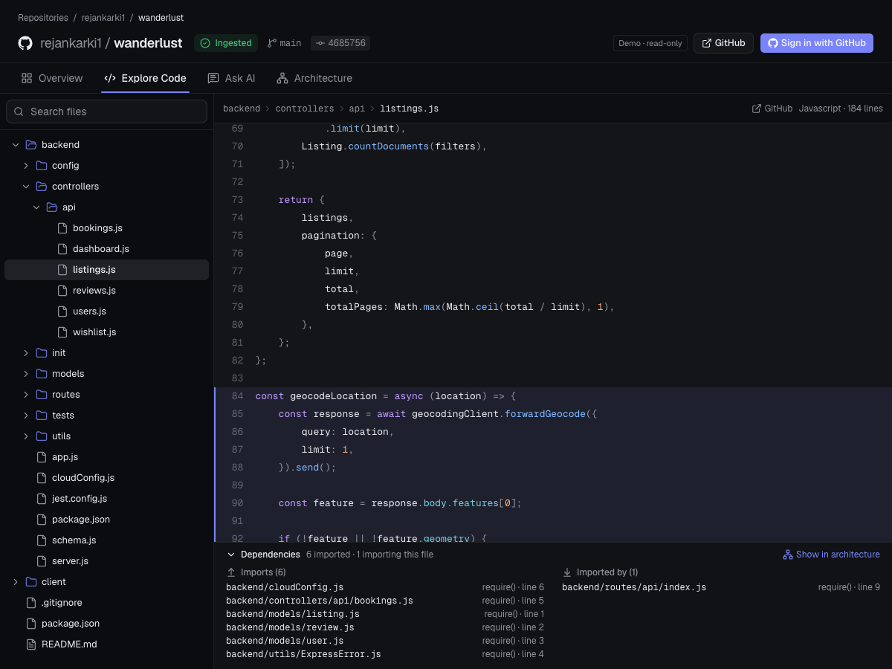
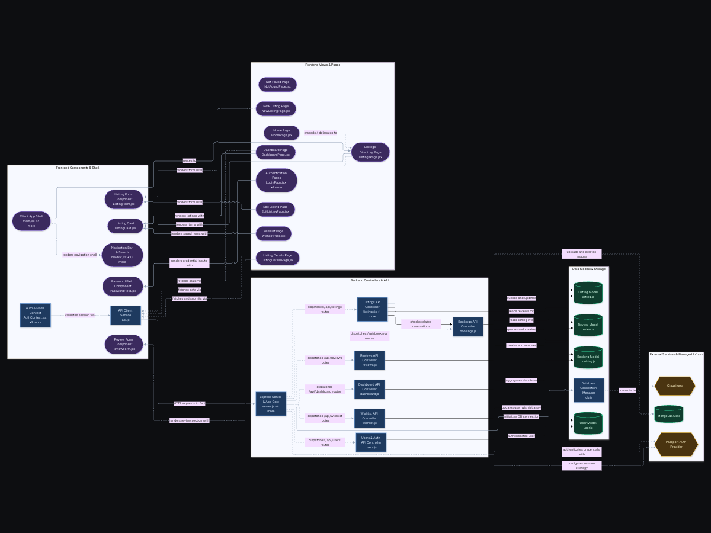
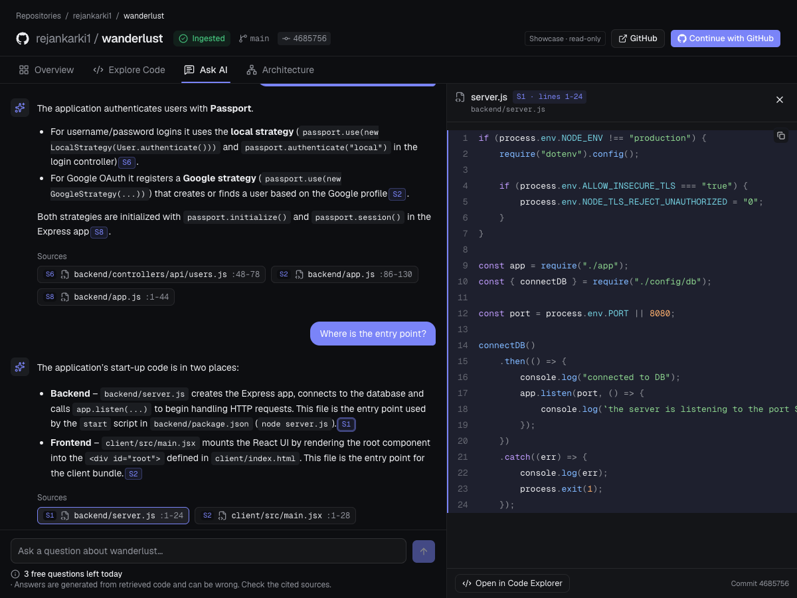
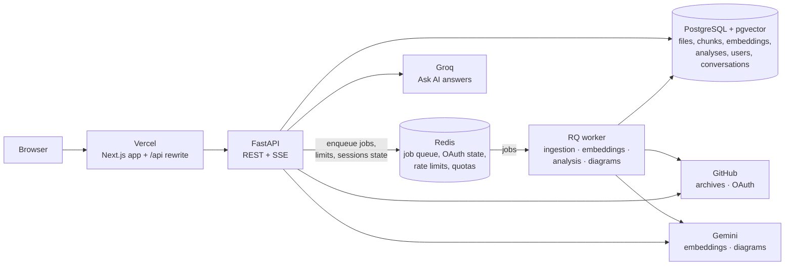

# RepoLens

**Understand any public GitHub repository: browse its code, see how its components connect, and ask questions that are answered from the source itself, with citations to the exact files and lines.**

[](https://github.com/rejankarki1/repoLens/actions/workflows/backend-ci.yml)
[](https://github.com/rejankarki1/repoLens/actions/workflows/frontend-ci.yml)
[](https://github.com/rejankarki1/repoLens/actions/workflows/e2e-smoke.yml)

## Live demo

**<https://repo-lens-bice.vercel.app> — no sign-in required. Click _Try Demo_.**

Two real repositories (Wanderlust and classLens) are already indexed. You can browse the code and the AI-generated architecture diagrams without an account. Signing in with GitHub (public profile only, no repository access) lets you import and ask questions about your own repositories.

> **Cold starts.** The demo runs on free hosting tiers. The API sleeps when idle, so the first request of a visit can take up to a minute while it wakes up; the app shows a "Starting the server" note while it waits. After that it is fast.

## What RepoLens does

Paste a public GitHub URL. A background worker downloads the repository, splits its code into structure-aware chunks, indexes them for keyword and semantic search, and maps the imports between files. You get three views of it:

- **Ask AI** answers questions from retrieved code only, streamed, with `[S1]`-style citations that are validated against what was actually retrieved. Clicking one opens the cited lines. Conversations are saved per user.
- **Code Explorer** is a file tree and source viewer with line deep links and a panel of what each file imports and what imports it.
- **Architecture Explorer** is an AI-identified diagram of the repository's functional components, with pan, zoom and a minimap. Every relationship is marked as verified by a real import or merely inferred.

Visitors can browse an allow-listed set of showcase repositories read-only. Signed-in users get a private workspace and private conversations; the stored copy of a public repository is shared by everyone who analyzes it.

## Screenshots

Captured from the live demo on the Wanderlust repository. The architecture diagram is shown in full, scaled to fit; click it for the full-resolution image.

| Code Explorer | Architecture Explorer |
| --- | --- |
|  | [](docs/images/architecture-explorer-full.png) |



## System architecture



In production the browser only talks to the Vercel origin: `/api/*` is rewritten to the Render service, so the session cookie stays first-party and no CORS is involved. One Render container runs the API and the single worker under a small supervisor. The provider that writes Ask AI answers is a setting (`GENERATION_PROVIDER`, Gemini or Groq); the hosted demo uses Groq for answers and Gemini for embeddings and architecture diagrams.

## Technology stack

| Area | Technology |
| --- | --- |
| Web app | Next.js 16 (App Router), React 19, TypeScript, Tailwind CSS 4, SWR, Base UI/shadcn components, Mermaid |
| API | Python 3.14, FastAPI, SQLAlchemy 2 (async, asyncpg), Alembic, httpx, Pydantic Settings |
| Background jobs | Redis, RQ (one worker, retries scheduled by RQ) |
| Code parsing | tree-sitter via `tree-sitter-language-pack` |
| Database and vectors | PostgreSQL 17, pgvector (1,536-dimension vectors, cosine distance) |
| AI providers | Google Gemini (`gemini-embedding-001` embeddings; answers and diagrams optional), Groq (answers) |
| Authentication | GitHub OAuth (authorization code + PKCE, no scopes), server-side sessions |
| Hosting (demo) | Vercel (web), Render (API + worker, Docker), Neon (PostgreSQL), hosted Redis |
| Testing | pytest on real PostgreSQL and Redis, `node --test` unit tests, headless-Chrome smoke test with a fake GitHub |

## Engineering highlights

- **Grounded, checkable answers.** Retrieval is hybrid: PostgreSQL full-text search, exact symbol and file-name matching, and pgvector similarity, fused with Reciprocal Rank Fusion and scoped to the repository's current commit. Citations are rebuilt from the retrieved chunks and any marker that matches nothing retrieved is removed, so the model cannot invent a source. [docs/rag.md](docs/rag.md), [docs/search.md](docs/search.md)
- **A diagram that cannot overstate itself.** The AI proposes components and relationships, but the backend drops any source path not in the snapshot and recomputes every relationship's confidence from real import edges. Only a verified import can be labelled "verified". [docs/architecture-diagram.md](docs/architecture-diagram.md)
- **Reliable background jobs.** Ingestion is a state machine in PostgreSQL with heartbeats, one retry for transient failures and a sweeper that recovers jobs lost to a crashed or sleeping worker. A failed re-ingestion keeps serving the previous snapshot. Archives are read defensively: unsafe paths and symlinks are rejected, size limits never trust a ZIP entry's declared size, and files that look like secrets are skipped.
- **Security and cost controls.** GitHub OAuth with PKCE and no scopes, HttpOnly server-side sessions, CSRF tokens, and per-user ownership checks on every endpoint. Usage limits (AI questions, imports, embedding and diagram jobs) are enforced atomically in Redis, with a global daily budget as the hard ceiling on spend. [docs/security.md](docs/security.md)
- **Resilient UI.** A failed background refetch keeps the cached repository, diagram and file on screen instead of replacing them with an error, so an in-progress Ask AI stream survives a network blip. Versioned data is not revalidated on focus, very large files fall back to plain text, and a "Starting the server" note appears only after a slow load.
- **Tests that cannot touch real data.** Over 1,000 backend tests run on real PostgreSQL and Redis against disposable databases, and refuse to start against a non-local server. A headless-Chrome smoke test drives sign-in, the guest showcase, imports and user isolation against a fake GitHub. CI runs all of it, plus migration checks (`alembic check` and a downgrade/upgrade round trip), on every pull request.

## Testing

```bash
apps/api/venv/bin/python -m pytest -q                 # backend: needs local PostgreSQL + Redis; uses its own repolens_test database and Redis db 15
cd apps/web && npm test && npm run typecheck && npm run lint && npm run build
python -m tests.e2e.run_smoke                        # browser smoke test: isolated stack with a fake GitHub (needs Chrome)
```

The backend suite never reaches development data: before the settings are read, `tests/conftest.py` points them at a disposable database, Redis database and queue, blanks every provider key, and refuses to run against a non-local host or a database it did not create. The smoke test does the same with its own database (`repolens_e2e`), Redis database 9 and ports. All three run in GitHub Actions on every push and pull request to `main`, with throwaway services and no AI, OAuth or GitHub credentials.

## Local development setup

You need Python 3.14, Node.js 22.18 or newer, and Docker. Run every command from the repository root unless noted.

```bash
# 1. Local settings and services (PostgreSQL with pgvector, Redis)
cp .env.example .env
docker compose up -d && docker compose ps

# 2. API: virtual environment, dependencies, migrations, tree-sitter grammars (downloaded once)
python3 -m venv apps/api/venv
apps/api/venv/bin/python -m pip install -r apps/api/requirements-dev.txt
apps/api/venv/bin/alembic upgrade head
apps/api/venv/bin/python -c "from apps.api.services.code_parser import ensure_grammars; ensure_grammars()"

# 3. Web app dependencies
(cd apps/web && npm ci)
```

Start each process in its own terminal:

```bash
docker compose up -d                                              # PostgreSQL + Redis
apps/api/venv/bin/uvicorn apps.api.main:app --reload --port 8765  # FastAPI
apps/api/venv/bin/python -m apps.api.worker                       # RQ worker
cd apps/web && npm run dev                                        # Next.js on http://localhost:3000
```

Open `http://localhost:3000` (use `localhost`, not `127.0.0.1`: the session cookie needs the web app and the API on the same site). `http://localhost:8765/docs` is the API reference and `/health/ready` reports PostgreSQL and Redis.

**Sign-in and AI are optional locally.** Without a GitHub OAuth App nobody can sign in or import. Without `GEMINI_API_KEY`, search is keyword-only and no diagrams can be generated; without a Groq or Gemini key, Ask AI returns 503. To enable sign-in, create a GitHub OAuth App (Settings → Developer settings → OAuth Apps) with homepage `http://localhost:3000` and callback `http://localhost:8765/auth/github/callback`, and put its id and secret in `.env` (or in the optional `.env.oauth-check` overlay described in [docs/oauth-verification.md](docs/oauth-verification.md)). To let visitors browse without signing in, import repositories first and list them in `GUEST_SHOWCASE_REPOSITORIES`.

<details>
<summary>Troubleshooting</summary>

| Symptom | Fix |
| --- | --- |
| `ConnectionRefusedError` on port 5433 or 6379 | Docker is not running: start it, then `docker compose up -d`. |
| `No script_location` from Alembic | Run it from the repository root. |
| Imports stay "queued" | The worker is not running, or listens on another `INGESTION_QUEUE_NAME`. |
| Indexing stuck at "embedding" | Gemini's free tier rate-limits embeddings; use **Resume indexing** in the Ask AI panel. |

</details>

## Environment variables

All settings are read by `apps/api/config.py` from `.env` (and `.env.oauth-check` if present); shell variables override both. `.env.example` lists them with their defaults. The main ones:

| Variable | Purpose |
| --- | --- |
| `DATABASE_URL`, `REDIS_URL` | PostgreSQL (asyncpg; a provider-style `postgresql://…?sslmode=require` URL is converted) and Redis |
| `WEB_ORIGINS`, `WEB_BASE_URL`, `API_PUBLIC_URL` | CORS/CSRF allow-list, where the browser returns after sign-in, and the API's public URL (the OAuth callback is `<API_PUBLIC_URL>/auth/github/callback`) |
| `GITHUB_OAUTH_CLIENT_ID`, `GITHUB_OAUTH_CLIENT_SECRET` | The GitHub OAuth App (secret: `.env` or the host's secret store only) |
| `GITHUB_TOKEN` | Optional token for GitHub API calls (60 → 5,000 requests per hour) |
| `GEMINI_API_KEY`, `EMBEDDING_MODEL`, `GEMINI_GENERATION_MODEL` | Embeddings (required for semantic search) and Gemini answers |
| `GENERATION_PROVIDER`, `GROQ_API_KEY`, `GROQ_GENERATION_MODEL` | `gemini` (default) or `groq` for Ask AI answers; no automatic fallback |
| `ARCHITECTURE_DIAGRAM_GENERATION_PROVIDER` | Provider for diagram generation only (the demo uses `gemini` because a diagram prompt exceeds the Groq model's request limit) |
| `GUEST_SHOWCASE_REPOSITORIES` | `owner/name` list visitors may browse read-only; nothing is public unless listed |
| `GUEST_AI_ENABLED`, `GUEST_AI_*` | Optional live questions for visitors, capped per visitor and for all visitors |
| `AI_*`, `IMPORT_*`, `EMBEDDING_*`, `ARCHITECTURE_*`, `MAX_*` | Usage limits and size caps (defaults in `.env.example` and `apps/api/config.py`) |
| `ENVIRONMENT=production` | Secure `__Host-` cookies, HSTS and CSP, API docs off, and a start-up check that refuses unsafe settings |
| `NEXT_PUBLIC_API_URL`, `API_ORIGIN` (web app) | Where the browser finds the API (`/api` in production, proxied to `API_ORIGIN`); build-time values, never secrets |

Never commit `.env` or put a secret in a `NEXT_PUBLIC_*` variable. [docs/deployment.md](docs/deployment.md) has the production checklist.

## Limitations and future improvements

- **Public repositories only, and size-limited.** Archives over 25 MiB (10 MiB on the hosted demo), files over 1 MiB, and anything beyond 5,000 files or 50 MiB per repository are skipped, so very large monorepos are stored partially and flagged as truncated. Details: [docs/search.md](docs/search.md#from-repository-to-index-ingestion).
- **Structure-aware parsing covers Python, JavaScript, TypeScript and TSX.** Other languages are indexed as plain text and do not appear in the import graph or the architecture diagram.
- **Semantic search is capped** at 10,000 embedded chunks per repository (3,000 on the demo); the rest is keyword-only. There is no approximate-nearest-neighbour index yet, which is fine at this scale.
- **Answers are only as good as retrieval.** The model sees at most 8 excerpts, so broad questions about a large repository can miss relevant code. The citations make this visible rather than hidden.
- **The AI diagram is model output**, bounded by the deterministic analysis it reads and non-deterministic between runs. Relationships other than imports are always marked inferred, and a large repository can produce a diagram bigger than fits on screen at a readable zoom.
- **No answer caching.** Every question is a live retrieval and generation, within the per-user and global quotas.
- **Free-tier hosting.** Cold starts of up to a minute, and the worker sleeps with the API, so queued imports wait for the next visit. Quotas are deliberately low. Per-IP limits behind the hosting proxies act as one shared bucket, which can only over-limit.
- **Possible next steps:** more tree-sitter grammars, an HNSW index once repositories grow, account deletion and data export, and garbage collection of embeddings whose repositories were removed.

## Documentation

| Document | Covers |
| --- | --- |
| [docs/deployment.md](docs/deployment.md) | Hosting on Vercel + Render + Neon + Redis, free-tier guards, publishing the showcase, update order |
| [docs/rag.md](docs/rag.md) | Conversations, retrieval, prompt building, citation validation, providers |
| [docs/search.md](docs/search.md) | Ingestion and indexing, keyword/exact/semantic search, embeddings, jobs and rate limits |
| [docs/architecture.md](docs/architecture.md) | The deterministic import graph: endpoints, graph model, evidence |
| [docs/architecture-diagram.md](docs/architecture-diagram.md) | The AI diagram: context selection, validation rule, storage, limits |
| [docs/auth-design.md](docs/auth-design.md), [docs/security.md](docs/security.md) | Sign-in flow, sessions, CSRF, authorization, usage limits, operator duties |
| [docs/auth-migration.md](docs/auth-migration.md), [docs/oauth-verification.md](docs/oauth-verification.md) | Upgrading a pre-auth database; checking a real OAuth App in isolation |
| [docs/release-baseline.md](docs/release-baseline.md), [docs/verification-m1.md](docs/verification-m1.md), [docs/ux-audit.md](docs/ux-audit.md) | What was verified, and when (dated records) |
| [docs/erd.md](docs/erd.md) | Historical schema design; the migrations and `apps/api/models/entities.py` are the source of truth |

<details>
<summary>Repository layout</summary>

```text
apps/api/        FastAPI service, RQ worker, jobs, services (ingestion, search, RAG, architecture), scripts
apps/web/        Next.js app (app/, components/, lib/) and its unit tests
database/        Alembic migrations
docs/            Design and operations documentation, and README images
tests/           Backend tests and the browser smoke test (tests/e2e)
.github/         CI workflows
docker-compose.yml, Dockerfile, render.yaml, alembic.ini, .env.example
```

</details>
