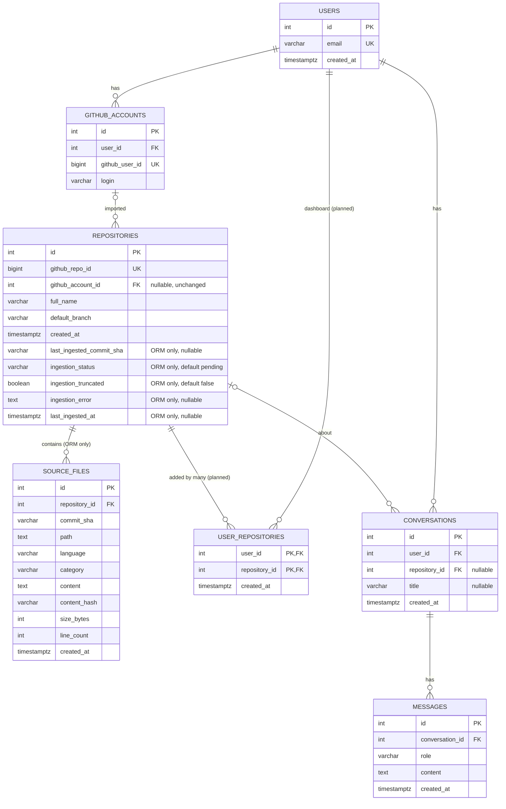

# RepoLens — Entity Relationship Design

Phase 2.3 design, kept in step with the approved SQLAlchemy models in `apps/api/models/entities.py`. The Alembic migration for the new tables and columns has **not** been generated or applied yet.

Visual diagram: [erd.svg](erd.svg) (open in VS Code or a browser). The Mermaid blocks below show the same design as text.

## Legend

Three states, shown the same way in [erd.svg](erd.svg):

| State | Meaning | Tables / columns |
| --- | --- | --- |
| **Migrated** | In the database today (`0001_foundation_tables.py`) and in the ORM. | `users`, `github_accounts`, `repositories` (original columns), `conversations`, `messages` |
| **ORM only, not yet migrated** | Approved SQLAlchemy model exists; no migration yet, so the database does not have it. | `source_files`; the five new `repositories` columns |
| **Planned, no ORM** | Design only. No model, no migration. | `user_repositories` |

---

## 1. Full schema

---

## 2. Migrated vs. not yet migrated vs. planned

| Table | Status | Notes |
| --- | --- | --- |
| `users`, `github_accounts`, `conversations`, `messages` | Migrated, unchanged | Created in migration 0001; nothing in the API uses them yet. |
| `repositories` | Migrated; **5 columns ORM only** | `github_account_id` is unchanged. New columns are nullable or have server defaults, so existing rows survive the migration. |
| `source_files` | **ORM only, not yet migrated** | File metadata and full source text in one table. |
| `user_repositories` | **Planned, no ORM** | Sketched so 2.3 doesn't block it. |

## 3. Keys and constraints

**Migrated (unchanged)**
- Every table has an integer `id` primary key.
- Unique: `users.email`, `github_accounts.github_user_id`, `repositories.github_repo_id`.
- `github_accounts.user_id` → `users.id` (CASCADE); `repositories.github_account_id` → `github_accounts.id` (SET NULL, nullable); `conversations.user_id` → `users.id` (CASCADE); `conversations.repository_id` → `repositories.id` (SET NULL, nullable); `messages.conversation_id` → `conversations.id` (CASCADE).
- `messages.role` has a CHECK constraint (`system`, `user`, `assistant`).

**New on `repositories` (ORM only)**
- `last_ingested_commit_sha` — `varchar(40)`, nullable; commit of the snapshot most recently stored. NULL until the first successful ingestion.
- `ingestion_status` — `varchar(20)`, NOT NULL, default `pending`; CHECK `valid_ingestion_status` (`pending`, `in_progress`, `completed`, `failed`).
- `ingestion_truncated` — boolean, NOT NULL, default false; true if the archive reader hit a limit and skipped files.
- `ingestion_error` — text, nullable; last failure message.
- `last_ingested_at` — timestamptz, nullable; time of the last successful ingestion.

**`source_files` (ORM only)**
- PK `id`.
- FK `repository_id` → `repositories.id`, `ON DELETE CASCADE`.
- **Unique `uq_source_files_repository_commit_path` on `(repository_id, commit_sha, path)`.**
- CHECK `valid_source_file_category` on `category`: `source`, `test`, `docs`, `config`, `other` (matches `Category` in `apps/api/services/archive_reader.py`).
- Columns: `id`, `repository_id`, `commit_sha` varchar(40), `path` text, `language` varchar(64), `category` varchar(20), `content` text, `content_hash` varchar(64), `size_bytes` int, `line_count` int, `created_at` timestamptz (server default `now()`).
- The unique constraint's leading column is `repository_id`, so lookups by repository are already indexed.

**`user_repositories` (planned, no ORM)**
- Composite PK `(user_id, repository_id)`; both are FKs with `ON DELETE CASCADE`.

## 4. How source files are stored

One row per file, with the text itself in `source_files.content` (PostgreSQL `TEXT`). Columns map directly onto the existing `SourceFile` dataclass from Phase 2.2B:

| Column | From |
| --- | --- |
| `path`, `language`, `category`, `content`, `size_bytes`, `line_count` | `SourceFile` fields of the same name |
| `content_hash` | `SourceFile.sha256` (64-char hex) |
| `created_at` | database default, not from `SourceFile` |
| `commit_sha` | the commit the archive was fetched at (same for every row of a repository's snapshot) |

There is no `file_contents` table. Identical content is not deduplicated across files, repositories or commits; that is the accepted trade-off for a simpler schema.

## 5. Re-ingestion: replacing files safely

Only the latest successfully ingested snapshot is kept. Because the unique key includes `commit_sha`, rows for the old and new commit can sit side by side, so the new snapshot can be written without touching the old one. The persistence service (not built yet) is responsible for enforcing "latest only":

1. In its own committed transaction, set `ingestion_status = 'in_progress'`.
2. Fetch and parse the new archive **before** touching `source_files`. If this fails, set `ingestion_status = 'failed'` and `ingestion_error`; the old files are untouched.
3. In **one transaction**: insert the new commit's rows, delete the rows of any other commit for this repository, then set `last_ingested_commit_sha`, `ingestion_truncated`, `last_ingested_at`, `ingestion_status = 'completed'`, and clear `ingestion_error`.
4. If anything in step 3 fails, the transaction rolls back and the previous snapshot is fully intact. The failure is then recorded (status `failed`) in a separate transaction.

Readers see either the complete old snapshot or the complete new one. The database does not itself stop two commits from coexisting; only the service's delete-other-commits step does. Re-ingesting the same commit must replace that commit's rows (delete then insert in the same transaction) to avoid hitting the unique constraint.

## 6. Future: per-user dashboards, shared public data

`repositories.github_repo_id` is already globally unique, so a public repository has exactly one `repositories` row and one set of `source_files`, no matter how many users care about it. When `user_repositories` is built, each user's dashboard is just the rows in that join table for their `user_id`; adding the same repo twice is blocked by the composite PK, and removing it from a dashboard deletes only the join row, not the shared files.

`github_account_id` stays untouched in 2.3. It remains "which account first imported this repo" and is not used for dashboard membership.

One behavior change to plan for later: the current "409 if `github_repo_id` already exists" on `POST /repositories` will need to become "reuse the existing repository and add a `user_repositories` row for the caller."

---

## 7. Open points

1. **"Latest only" is enforced by the service, not the schema.** With `(repository_id, commit_sha, path)` as the key, nothing at the database level prevents rows from two commits coexisting. The service must delete other commits' rows in the same transaction that inserts the new ones.
2. **`commit_sha` is redundant by design.** After a successful ingestion it equals `repositories.last_ingested_commit_sha` for every row of that repository.
3. **No `ingestion_started_at`.** A stuck `in_progress` row can't be aged out without a start time. Add one later if stale-run cleanup matters.
4. **NUL bytes.** PostgreSQL `TEXT` rejects `\x00`. Confirm the Phase 2.2B reader filters it before the persistence service inserts `content`.
